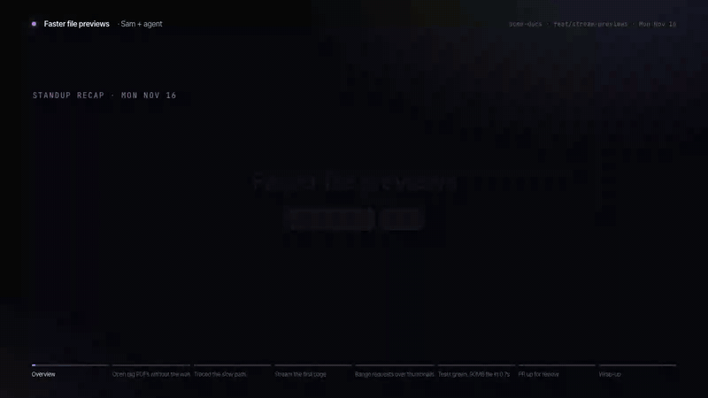
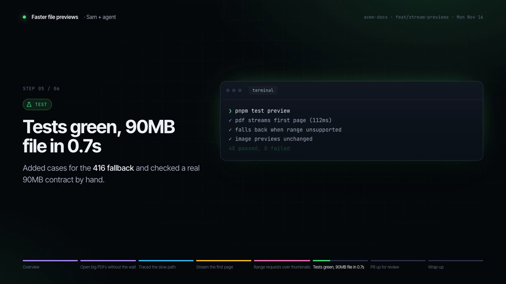

# visual-recap

A plugin for AI coding agents that turns what the agent did into an animated, narrated recap you can
play at standup. The result is one HTML file: open it, press play, and it walks through the work step
by step with real diffs, real terminal output and an optional natural-sounding voice.

- Reads the session history Claude Code and Codex already keep on your machine, with secrets
  redacted. Nothing extra runs while you work.
- `/standup` condenses the work into 4 to 7 story beats: plan, explore, edit, run, test, fix, decide, ship.
- Builds a self-contained 16:9 player you can open in any browser or screen-share.
- Exports an MP4 on request, for anywhere that plays video but not HTML.
- Optional voice from Kokoro, a free open-source neural voice that runs on your own machine.
  The audio is baked into the HTML file, so it sounds the same for everyone you send it to.



| | |
|---|---|
|  |  |
|  |  |

## How it fits together

The repository holds two things:

- `plugins/standup-recap/`: the plugin itself, plain text only. It is a skill (how the agent turns
  the history into a good story) and a `/standup` command.
- `packages/visual-recap/`: the `visual-recap` command line tool. It reads the history, builds the
  player, voices it and exports the MP4. The skill runs it straight from this repository with
  `npx github:da3ferg/visual-recap#v0.4.0`, pinned to a release tag, so there is nothing to install by
  hand and no npm account involved.

## Requirements

| What | Why | Check |
|---|---|---|
| Claude Code or Codex | runs the plugin | `claude --version` or `codex --version` |
| Node.js 18 or newer | runs `visual-recap` through `npx` | `node --version` |
| Python 3.10 to 3.13 (optional) | only for the voice (kokoro-onnx does not support 3.14 yet) | `python3.13 --version` |
| ffmpeg (optional) | shrinks voice clips to MP3, and is required for MP4 export | `ffmpeg -version` |
| Playwright (optional) | only for MP4 export; uses your installed Chrome | `npm ls -g playwright` |

On a Mac, the optional tools come from Homebrew:

```bash
brew install python@3.13 ffmpeg
```

On Ubuntu or Debian:

```bash
sudo apt install python3 python3-venv ffmpeg
```

## Install

### Claude Code

Inside Claude Code, run these two commands:

```
/plugin marketplace add da3ferg/visual-recap
/plugin install standup-recap@standup-recap-marketplace
```

### Codex

```bash
codex plugin marketplace add da3ferg/visual-recap
```

```bash
codex plugin add standup-recap@standup-recap-marketplace
```

The first recap downloads `visual-recap` from GitHub, so Codex asks once to allow network access.

### Any agent, with the skills CLI

```bash
npx skills add da3ferg/visual-recap
```

Installs the `standup-recap` skill for Claude Code, Codex, Cursor and the other agents the
[skills CLI](https://skills.sh) supports.

### Any other agent

Give the agent `plugins/standup-recap/skills/standup-recap/SKILL.md` as its instructions, or run the
tool yourself (see Build by hand). `visual-recap gather` reads Claude Code and Codex history; other
agents can still write a `recap.json` from their own conversation and build it.

## Make a recap

```
/standup                        # today's work in this project, silent
/standup this session           # only the current conversation
/standup since friday           # a longer window
/standup with voice             # add the Kokoro narration
/standup this session with voice, use am_michael
/standup with voice as mp4      # also export a video
```

Those are Claude Code commands. In Codex, ask the same things in plain words ("make a standup recap
of today's work, with voice").

The agent reads the history, writes the story to `.standup/recaps/recap.json`, builds the player and
opens it. The finished file is `.standup/recaps/<date>-<title>.html`. Any session you have had in the
project counts, including ones from before you installed the plugin.

## Get the voice

Recaps are silent unless you ask for a voice. Asking is all it takes: say "with voice" in `/standup`,
name a voice, or pass `--tts kokoro` to `visual-recap build`.

### What happens the first time

The first voiced recap sets everything up by itself. Expect one to three minutes:

1. It looks for a Python that already has Kokoro installed, in this order:
   `$STANDUP_PYTHON`, then `~/.standup/kokoro-venv`, then `~/.hyperframes-kokoro`.
2. If none is found, it creates a private virtual environment at `~/.standup/kokoro-venv` and runs
   `pip install kokoro-onnx soundfile` there, preferring Python 3.13 down to 3.10. Nothing is
   installed into your system Python.
3. It downloads two model files (about 120 MB in total) from the
   [kokoro-onnx release](https://github.com/thewh1teagle/kokoro-onnx/releases/tag/model-files-v1.0)
   into `~/.standup/voices/`:
   - `kokoro-v1.0.int8.onnx`
   - `voices-v1.0.bin`
4. It voices each scene (roughly 3 to 10 seconds per scene on a laptop) and embeds the clips in the HTML.

After that, every voiced recap reuses the same environment and model files, works offline, and costs
nothing.

### Set it up ahead of time (optional)

```bash
python3.13 -m venv ~/.standup/kokoro-venv
```

```bash
~/.standup/kokoro-venv/bin/pip install kokoro-onnx soundfile
```

```bash
mkdir -p ~/.standup/voices && curl -L -o ~/.standup/voices/kokoro-v1.0.int8.onnx https://github.com/thewh1teagle/kokoro-onnx/releases/download/model-files-v1.0/kokoro-v1.0.int8.onnx
```

```bash
curl -L -o ~/.standup/voices/voices-v1.0.bin https://github.com/thewh1teagle/kokoro-onnx/releases/download/model-files-v1.0/voices-v1.0.bin
```

### Hear it right away

Build the bundled example with the voice and open it:

```bash
npx -y github:da3ferg/visual-recap#v0.4.0 example ~/standup-demo.json && npx -y github:da3ferg/visual-recap#v0.4.0 build ~/standup-demo.json ~/standup-demo.html --tts kokoro && open ~/standup-demo.html
```

(On Linux use `xdg-open` instead of `open`.)

The player opens on a start screen. Click **Play with narration**. Browsers only allow sound after a
click, which is why it waits there. Each slide holds until its voice clip finishes.

### Pick a voice

Say "use the bf_emma voice" in `/standup`, or pass `--voice` to `visual-recap build`. Good ones:

| Voice | Sound |
|---|---|
| `af_heart` | warm, American female (default) |
| `af_bella` | bright, American female |
| `am_michael` | calm, American male |
| `am_fenrir` | deeper, American male |
| `bf_emma` | British female |
| `bm_george` | British male |

A wrong name prints the full list of available voices.

### Other voice sources

`visual-recap build` also takes `--tts openai` (reads `OPENAI_API_KEY`), `--tts elevenlabs` (reads
`ELEVENLABS_API_KEY`) and `--audio-dir <folder>` for your own recordings (`0.mp3` for the intro, `1.mp3`
and on for each step, the last one for the wrap-up). The plugin's skill only uses Kokoro.

To see exactly what will be spoken before generating anything:

```bash
npx -y github:da3ferg/visual-recap#v0.4.0 build .standup/recaps/recap.json --print-script
```

If voice generation fails, the build still finishes and you get a silent recap. The error explains why.

## Play it

| Key | Action |
|---|---|
| ← → | previous or next step |
| Space | pause or resume |
| V | voice on or off (voiced recaps only) |
| F | fullscreen |
| Home, End | first or last step |

URL options: `?step=3` jumps to a step, `?paused` freezes on it, `?autoplay` skips the start screen
silently, `?voice` starts narrated. Controls hide while presenting and come back when you move the mouse.

## Export an MP4

Most chat apps, email and docs will not play an HTML file inline, but they will play a video. Ask for
one ("/standup with voice as mp4", or "export that recap as a video"), or run:

```bash
npm i -g playwright
```

```bash
npx -y github:da3ferg/visual-recap#v0.4.0 export .standup/recaps/<date>-<title>.html
```

Add `--portrait` for a 1080x1920 vertical video (TikTok, Reels, Shorts): the player stacks each panel under its text. The HTML player also switches to this layout on its own on a phone held upright.

The MP4 is written next to the HTML. The exporter plays the recap in headless Chrome at 1600x900,
records it, and lays the Kokoro clips over the video at the moment each scene starts. It takes about
as long as the recap runs (a 90 second recap takes about 90 seconds) and makes a file of a few MB.
The first run downloads Playwright's small video recorder (about 1 MB). If Google Chrome is not
installed, run `npx playwright install chromium` once.

## Build by hand

`visual-recap` works without any agent:

```bash
npx -y github:da3ferg/visual-recap#v0.4.0 gather --since 2026-11-14
```

```bash
npx -y github:da3ferg/visual-recap#v0.4.0 build .standup/recaps/recap.json out.html --tts kokoro --voice am_michael
```

`gather` prints the timeline of this project's Claude Code and Codex sessions (`--source claude` or
`--source codex` for one of them, `--session <id>` for one session). `build` validates `recap.json`
first and tells you what is wrong if a step is missing a field. The format is documented in
`plugins/standup-recap/skills/standup-recap/SKILL.md`, and `npx -y github:da3ferg/visual-recap#v0.4.0 example` prints a full
sample.

## Troubleshooting

| Problem | Fix |
|---|---|
| "No Claude Code or Codex sessions for this project" | The recap only reads sessions started in this folder. Open the agent in the project and try again. |
| Codex says the `npx` command failed | Allow network access when Codex asks; `npx` downloads `visual-recap` from GitHub the first time. |
| "Python 3.10 to 3.13 is needed for the Kokoro voice" | Install Python 3.13 (see Requirements), then build again. |
| `pip install kokoro-onnx failed` | Usually a Python that is too new. Install Python 3.13, delete `~/.standup/kokoro-venv`, and build again. On Linux, install `python3-venv` first. |
| Model download fails or stops | Delete the partial files in `~/.standup/voices/` and build again, or download them with the curl commands above. |
| The HTML file is very large | Install ffmpeg so clips are stored as MP3 instead of WAV. |
| MP4 export says Playwright is needed | Run `npm i -g playwright`, then export again. |
| No sound | Click **Play with narration**, not **Play silently**, and check that the recap was built with a voice (the build prints `narration: embedded audio`). |

### Environment variables

| Variable | Effect |
|---|---|
| `STANDUP_PYTHON` | Python to use for Kokoro, if you already have `kokoro-onnx` installed somewhere |
| `STANDUP_VOICE` | default Kokoro voice |
| `STANDUP_VOICE_DIR` | where the model files live (default `~/.standup/voices`) |
| `CLAUDE_CONFIG_DIR`, `CODEX_HOME` | where Claude Code and Codex keep their history, if not the default |

## Privacy

- `visual-recap` reads Claude Code and Codex session files on your machine, only for the current
  project, and never sends them anywhere. Recaps are written to `.standup/` in the project, which
  ignores itself in git.
- API keys, tokens, passwords and credentials in URLs are redacted before anything reaches the recap.
- Kokoro runs entirely on your machine.

## Layout

```
.claude-plugin/marketplace.json      Claude Code marketplace
.agents/plugins/marketplace.json     Codex marketplace
plugins/standup-recap/               the plugin (text only)
  .claude-plugin/plugin.json         Claude Code manifest
  .codex-plugin/plugin.json          Codex manifest
  assets/icon.png                    plugin icon
  commands/standup.md                the /standup command (Claude Code)
  skills/standup-recap/
    SKILL.md                         how the agent turns the history into a good story
    assets/example-recap.json        a full sample recap
package.json                         lets npx run the tool from GitHub
packages/visual-recap/               the command line tool
  bin/visual-recap.js                gather | build | export | example
  lib/claude-log.js                  reads Claude Code transcripts
  lib/codex-log.js                   reads Codex session files
  lib/gather.js                      history → compact timeline for the agent to read
  lib/build.js                       recap.json → self-contained animated HTML
  lib/player.html                    the animated player
  lib/kokoro_tts.py                  Kokoro voice → one audio clip per scene
  lib/export.js                      recap HTML → MP4 with the voice
  test/                              run with npm test
```

## License

MIT. See [LICENSE](LICENSE).

## Credits

Narration uses [Kokoro](https://huggingface.co/hexgrad/Kokoro-82M) (Apache-2.0) through
[kokoro-onnx](https://github.com/thewh1teagle/kokoro-onnx).
