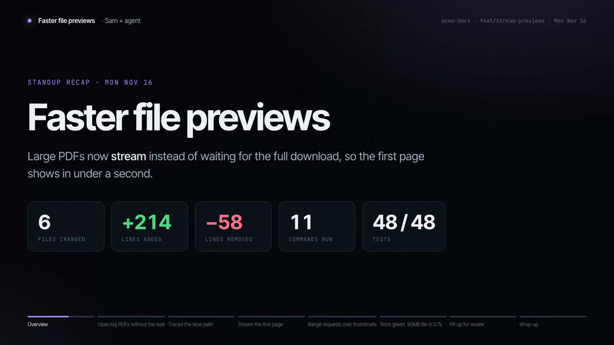
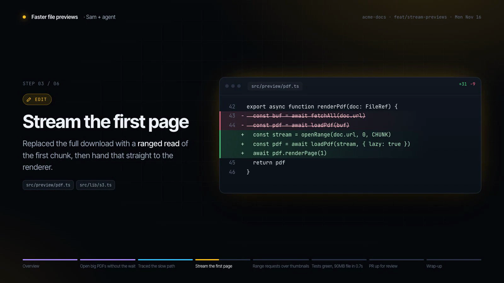
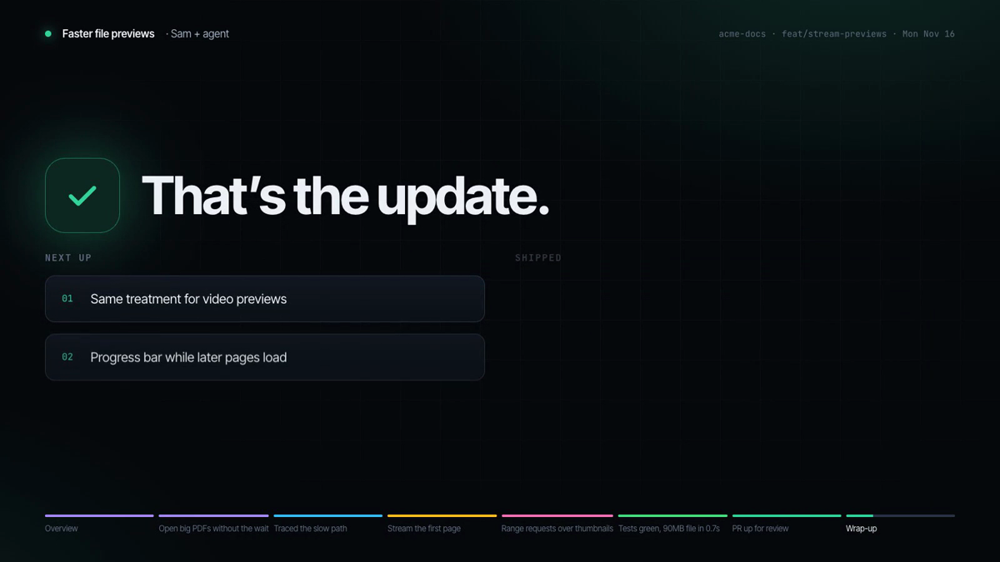

# visual-recap

A plugin for AI coding agents that records what the agent does while it works, then turns it
into an animated, narrated recap you can play at standup. The result is one HTML file: open it, press
play, and it walks through the work step by step with real diffs, real terminal output and an
optional natural-sounding voice.

- Records every prompt and tool call through the agent's hooks, with secrets redacted.
- `/standup` condenses the log into 4 to 7 story beats: plan, explore, edit, run, test, fix, decide, ship.
- Builds a self-contained 16:9 player you can open in any browser or screen-share.
- Exports an MP4 on request, for anywhere that plays video but not HTML.
- Optional voice from Kokoro, a free open-source neural voice that runs on your own machine.
  The audio is baked into the HTML file, so it sounds the same for everyone you send it to.


| | |
|---|---|
|  |  |
|  |  |

## Requirements

| What | Why | Check |
|---|---|---|
| A coding agent that runs hooks | runs the plugin | `claude --version` or your agent's equivalent |
| Node.js 18 or newer | hooks and the build script | `node --version` |
| Python 3.10 to 3.13 | only for the voice (kokoro-onnx does not support 3.14 yet) | `python3.13 --version` |
| ffmpeg (optional) | shrinks voice clips to MP3, and is required for MP4 export | `ffmpeg -version` |
| Playwright (optional) | only for MP4 export; uses your installed Chrome | `npm ls -g playwright` |

On a Mac, the optional tools come from Homebrew:

```bash
brew install python@3.13 ffmpeg
```

On Ubuntu or Debian:

```bash
sudo apt install python3 python3-venv ffmpeg
```

## Install

### Claude Code

Inside Claude Code, run these two commands:

```
/plugin marketplace add da3ferg/visual-recap
/plugin install standup-recap@standup-recap-marketplace
```

Then restart the agent (or run `/reload-plugins`) so the hooks load.

To check that recording works, do anything in a project (ask a question, read a file), then look for
today's log:

```bash
ls .standup/log/
```

You should see a file named like `2026-11-16.jsonl`. The `.standup` folder ignores itself in git,
so nothing from it gets committed.

### From a local copy

If you cloned this repository instead:

```bash
git clone https://github.com/da3ferg/visual-recap.git ~/source/visual-recap
```

```
/plugin marketplace add ~/source/visual-recap
/plugin install standup-recap@standup-recap-marketplace
```

Changes you make in that folder take effect at the next session start or after `/reload-plugins`.

### Codex

```bash
codex plugin marketplace add da3ferg/visual-recap
```

```bash
codex plugin add standup-recap@standup-recap-marketplace
```

In Codex the plugin installs no hooks. When you ask for a recap, it reads the session history Codex
already keeps in `~/.codex/sessions` for the current project, so nothing extra runs while you work
and there is nothing to set up first. Ask in plain words ("make a standup recap of today's work") or
call the skill with `$standup-recap`.

### Other agents

Everything the plugin does is plain Node.js. Any agent that can run a command on prompt submit,
after each tool call and at the end of a turn can record a log: point those three hooks at
`node plugins/standup-recap/scripts/log-event.js` (it reads the hook event as JSON on stdin, with the
fields `hook_event_name`, `session_id`, `cwd`, `prompt`, `tool_name`, `tool_input` and
`tool_response`). Then give the agent `plugins/standup-recap/skills/standup-recap/SKILL.md` as its
instructions for building a recap.

## Make a recap

```
/standup                        # today's work in this project, silent
/standup this session           # only the current conversation
/standup since friday           # a longer window
/standup with voice             # add the Kokoro narration
/standup this session with voice, use am_michael
/standup with voice as mp4       # also export a video
```

Those are Claude Code commands. In Codex, ask the same things in plain words.

The agent reads the log, writes the story to `.standup/recaps/recap.json`, builds the player and opens
it. The finished file is `.standup/recaps/<date>-<title>.html`.

In Claude Code, recording starts once the plugin is installed. In Codex, any session you have already
had in the project counts. If there is no history at all, the agent offers to build the recap from
`git log` and the conversation instead.

## Get the voice

Recaps are silent unless you ask for a voice. Asking is all it takes: say "with voice" in `/standup`,
name a voice, or pass `--tts kokoro` to the build script.

### What happens the first time

The first voiced recap sets everything up by itself. Expect one to three minutes:

1. It looks for a Python that already has Kokoro installed, in this order:
   `$STANDUP_PYTHON`, then `~/.standup/kokoro-venv`, then `~/.hyperframes-kokoro`.
2. If none is found, it creates a private virtual environment at `~/.standup/kokoro-venv` and runs
   `pip install kokoro-onnx soundfile` there, preferring Python 3.13 down to 3.10. Nothing is installed into your system Python.
3. It downloads two model files (about 120 MB in total) from the
   [kokoro-onnx release](https://github.com/thewh1teagle/kokoro-onnx/releases/tag/model-files-v1.0)
   into `~/.standup/voices/`:
   - `kokoro-v1.0.int8.onnx`
   - `voices-v1.0.bin`
4. It voices each scene (roughly 3 to 10 seconds per scene on a laptop) and embeds the clips in the HTML.

After that, every voiced recap reuses the same environment and model files, works offline, and costs
nothing.

### Set it up ahead of time (optional)

If you would rather do the setup before your first standup, run these yourself:

```bash
python3.13 -m venv ~/.standup/kokoro-venv
```

```bash
~/.standup/kokoro-venv/bin/pip install kokoro-onnx soundfile
```

```bash
mkdir -p ~/.standup/voices && curl -L -o ~/.standup/voices/kokoro-v1.0.int8.onnx https://github.com/thewh1teagle/kokoro-onnx/releases/download/model-files-v1.0/kokoro-v1.0.int8.onnx
```

```bash
curl -L -o ~/.standup/voices/voices-v1.0.bin https://github.com/thewh1teagle/kokoro-onnx/releases/download/model-files-v1.0/voices-v1.0.bin
```

### Hear it right away

Build the bundled example with the voice and open it:

```bash
node plugins/standup-recap/scripts/build.js plugins/standup-recap/skills/standup-recap/assets/example-recap.json ~/standup-demo.html --tts kokoro && open ~/standup-demo.html
```

(Run it from the repository folder. On Linux use `xdg-open` instead of `open`.)

The player opens on a start screen. Click **Play with narration**. Browsers only allow sound after a
click, which is why it waits there. Each slide holds until its voice clip finishes.

### Pick a voice

Say "use the bf_emma voice" in `/standup`, or pass `--voice` to the build script. Good ones:

| Voice | Sound |
|---|---|
| `af_heart` | warm, American female (default) |
| `af_bella` | bright, American female |
| `am_michael` | calm, American male |
| `am_fenrir` | deeper, American male |
| `bf_emma` | British female |
| `bm_george` | British male |

A wrong name prints the full list of available voices.

### Other voice sources

| Flag | Voice | Needs |
|---|---|---|
| `--tts kokoro [--voice af_heart]` | free local Kokoro voice (default when you ask for a voice) | Python 3 |
| `--tts openai [--voice coral]` | OpenAI text to speech, embedded as audio | `OPENAI_API_KEY` in your environment |
| `--tts elevenlabs [--voice <voice id>]` | ElevenLabs, embedded as audio | `ELEVENLABS_API_KEY` in your environment |
| `--audio-dir <folder>` | your own recordings | `0.mp3` for the intro, `1.mp3` and on for each step, the last one for the wrap-up |

To see exactly what will be spoken before generating anything:

```bash
node plugins/standup-recap/scripts/build.js .standup/recaps/recap.json --print-script
```

If voice generation fails, the build still finishes and you get a silent recap. The error explains why.

## Play it

| Key | Action |
|---|---|
| ← → | previous or next step |
| Space | pause or resume |
| V | voice on or off (voiced recaps only) |
| F | fullscreen |
| Home, End | first or last step |

URL options: `?step=3` jumps to a step, `?paused` freezes on it, `?autoplay` skips the start screen
silently, `?voice` starts narrated. Controls hide while presenting and come back when you move the mouse.

## Export an MP4

Most chat apps, email and docs will not play an HTML file inline, but they will play a video. Ask for
one ("/standup with voice as mp4", or "export that recap as a video"), or run:

```bash
npm i -g playwright
```

```bash
node plugins/standup-recap/scripts/export.js .standup/recaps/<date>-<title>.html
```

The MP4 is written next to the HTML. The exporter plays the recap in headless Chrome at 1600x900,
records it, and lays the Kokoro clips over the video at the moment each scene starts. It takes about
as long as the recap runs (a 90 second recap takes about 90 seconds) and makes a file of a few MB.
The first run downloads Playwright's small video recorder (about 1 MB). If Google Chrome is not
installed, run `npx playwright install chromium` once.

## Build by hand

The build script works on its own, for example after you edit `recap.json` yourself:

```bash
node plugins/standup-recap/scripts/build.js .standup/recaps/recap.json
```

```bash
node plugins/standup-recap/scripts/build.js .standup/recaps/recap.json out.html --tts kokoro --voice am_michael
```

It validates the file first and tells you what is wrong if a step is missing a field. The format is
documented in `plugins/standup-recap/skills/standup-recap/SKILL.md`, and
`assets/example-recap.json` is a full sample.

## Troubleshooting

| Problem | Fix |
|---|---|
| `.standup/log/` never appears (Claude Code) | Restart Claude Code after installing, and check `/plugin` lists `standup-recap` as enabled. |
| "no Codex sessions for this project" | The recap only reads sessions started in this folder or below it. Open Codex in the project and try again. |
| "Python 3.10 to 3.13 is needed for the Kokoro voice" | Install Python 3.13 (see Requirements), then build again. |
| `pip install kokoro-onnx failed` | Usually a Python that is too new. Install Python 3.13, delete `~/.standup/kokoro-venv`, and build again. On Linux, install `python3-venv` first. |
| Model download fails or stops | Delete the partial files in `~/.standup/voices/` and build again, or download them with the curl commands above. |
| The HTML file is very large | Install ffmpeg so clips are stored as MP3 instead of WAV. |
| MP4 export says Playwright is needed | Run `npm i -g playwright`, then export again. |
| No sound | Click **Play with narration**, not **Play silently**, and check that the recap was built with a voice (the build prints `narration: embedded audio`). |

### Environment variables

| Variable | Effect |
|---|---|
| `STANDUP_PYTHON` | Python to use for Kokoro, if you already have `kokoro-onnx` installed somewhere |
| `STANDUP_VOICE` | default Kokoro voice |
| `STANDUP_VOICE_DIR` | where the model files live (default `~/.standup/voices`) |
| `OPENAI_API_KEY`, `OPENAI_TTS_MODEL` | for `--tts openai` |
| `ELEVENLABS_API_KEY`, `ELEVENLABS_VOICE_ID` | for `--tts elevenlabs` |

## Privacy

- The log stays in your project's `.standup/` folder, which ignores itself in git. In Codex, the
  plugin only reads Codex's own session files on your machine and never copies them anywhere.
- API keys, tokens, passwords and credentials in URLs are redacted before anything is written.
- Kokoro runs entirely on your machine. The OpenAI and ElevenLabs options send the narration text
  (not your code) to those services.

## Layout

```
.claude-plugin/marketplace.json    Claude Code marketplace
.agents/plugins/marketplace.json   Codex marketplace
plugins/standup-recap/
  .claude-plugin/plugin.json       Claude Code manifest
  .claude-plugin/hooks.json        prompt, tool-call and end-of-turn hooks → log-event.js (Claude Code only)
  .codex-plugin/plugin.json        Codex manifest (skills only, no hooks)
  assets/icon.png                  plugin icon
  commands/standup.md              the /standup command (Claude Code)
  scripts/log-event.js             hook logger; never blocks the agent, always exits 0
  scripts/codex-log.js             reads Codex session files into the same timeline
  scripts/gather.js                log → compact timeline for the agent to read
  scripts/build.js                 recap.json → self-contained animated HTML
  scripts/kokoro_tts.py            Kokoro voice → one audio clip per scene
  scripts/export.js                recap HTML → MP4 with the voice
  skills/standup-recap/
    SKILL.md                       how the agent turns the log into a good story
    assets/player.html             the animated player
    assets/example-recap.json      a full sample recap
  test/codex-log.test.js           node test/codex-log.test.js
```

## Credits

Narration uses [Kokoro](https://huggingface.co/hexgrad/Kokoro-82M) (Apache-2.0) through
[kokoro-onnx](https://github.com/thewh1teagle/kokoro-onnx).
